# Sistema de Gestion de Stock - Mayorista de computacion

Trabajo Practico Integrador de **Programacion Orientada a Objetos**
Analista en Informatica - Universidad Nacional de San Antonio de Areco (UNSAdA)

## Integrantes

| Integrante | Etapa a cargo |
|------------|---------------|
| Julian Urquiza | Etapa 1 - Base del proyecto, Rubros, Articulos y patron Observer |
| Andres Granda | Etapa 2 - Proveedores y Compras a proveedores |
| Hernan Granda | Etapa 3 - Clientes, Facturacion, impresion, tests y documentacion |

## Tecnologias

- Java 17
- Spring Boot 3 (sin web: la aplicacion corre por consola con `CommandLineRunner`)
- Spring Data JPA / Hibernate
- Base de datos H2 en archivo (`./data/stockdb`), no hace falta instalar ningun motor
- JUnit 5 + Mockito para las pruebas unitarias
- Maven

## Funcionalidades

| Modulo | Funciones |
|--------|-----------|
| Rubros | Alta, baja, modificacion, busqueda (codigo / nombre) y listado |
| Articulos | Alta, baja, modificacion, busqueda (codigo / descripcion), listado, actualizacion de stock y reporte de articulos en stock minimo |
| Proveedores | Alta, baja, modificacion, busqueda (codigo / razon social) y listado |
| Compras | Registro de compras con varios renglones (aumenta el stock), listado general y filtro por rango de fechas |
| Clientes | Alta, baja, modificacion, busqueda (codigo / apellido / DNI) y listado |
| Facturacion | Emision con submenu para agregar y quitar articulos, modificacion, baja (devuelve el stock), listado con estado e impresion de facturas pendientes |
| Alertas | Aviso por consola en el momento en que un articulo queda con `stockActual <= stockMinimo` |

### Reglas de negocio principales

- Los codigos (rubro, articulo, proveedor, cliente, compra, factura) son unicos y se guardan en mayusculas.
- No se repiten CUIT de proveedores, DNI de clientes ni numeros de factura.
- No se puede borrar un rubro con articulos, un articulo que figure en compras o facturas, un proveedor con articulos o compras, ni un cliente con facturas.
- Una compra o factura necesita al menos un renglon, sin articulos repetidos y con cantidades mayores a cero.
- **Compra:** suma stock. **Factura:** resta stock. Si algun articulo no tiene stock suficiente la factura se rechaza completa (rollback) y no se descuenta nada.
- El precio de cada renglon de factura se toma del articulo al momento de emitirla.
- Al modificar una factura se devuelve el stock de los renglones anteriores y se descuentan los nuevos. La factura vuelve a quedar pendiente de impresion.
- Al dar de baja una factura se devuelve al stock todo lo facturado.
- Todos los errores de negocio se informan con `NegocioException` y el menu muestra el mensaje sin cortar el programa.

### Impresion de facturas

El enunciado pide que la factura pueda *imprimirse en papel o, caso contrario, quedar almacenada en la base de datos para imprimirla posteriormente*:

1. Al confirmar una factura el sistema pregunta si se quiere imprimir en ese momento.
2. **Si:** se muestra el comprobante formateado (`FacturaService.generarComprobante`) y la factura se marca con `impresa = true`.
3. **No:** queda guardada con `impresa = false`.
4. Desde la opcion **Imprimir factura pendiente** se listan las facturas no impresas (`findByImpresaFalse`) y se puede imprimir cualquiera.

## Arquitectura

Aplicacion en capas. Cada capa solo conoce a la de abajo:

```
ui (MenuConsola)            -> lee datos por teclado y muestra resultados
   |
service                     -> reglas de negocio, validaciones y transacciones
   |
repository (JpaRepository)  -> acceso a datos generado por Spring Data
   |
model (@Entity)             -> clases del dominio mapeadas a tablas H2
```

```
src/
├── main/
│   ├── java/ar/edu/unsada/stock/
│   │   ├── StockApplication.java     clase principal
│   │   ├── config/DataSeeder.java    datos de prueba si la base esta vacia
│   │   ├── exception/                NegocioException
│   │   ├── model/                    Rubro, Proveedor, Articulo, Cliente, Factura,
│   │   │                             DetalleFactura, CompraProveedor, DetalleCompra
│   │   ├── observer/                 ObservadorStock, SujetoStock, AlertaStockConsola
│   │   ├── repository/               un JpaRepository por entidad
│   │   ├── service/                  RubroService, ArticuloService, ProveedorService,
│   │   │                             CompraService, ClienteService, FacturaService
│   │   └── ui/MenuConsola.java       menus por consola
│   └── resources/application.properties
└── test/java/ar/edu/unsada/stock/service/
    ├── ArticuloServiceTest.java
    ├── ProveedorCompraServiceTest.java
    └── ClienteFacturaServiceTest.java
```

## Patron de diseno Observer

Requerimiento: *notificacion en tiempo real del articulo que llegue a su stock minimo*.

| Rol GoF | Clase |
|---------|-------|
| Sujeto (interfaz) | `SujetoStock`: `agregarObservador`, `quitarObservador`, `notificarObservadores` |
| Sujeto concreto | `ArticuloService` |
| Observador (interfaz) | `ObservadorStock`: `stockMinimoAlcanzado(Articulo)` |
| Observador concreto | `AlertaStockConsola` |

**Funcionamiento:**

1. Spring inyecta en `ArticuloService` todos los componentes que implementan `ObservadorStock` y los registra como observadores.
2. Todo cambio de stock pasa por `ArticuloService` (`aumentarStock`, `descontarStock`, `ajustarStock`, alta y modificacion).
3. Despues de guardar, si `stockActual <= stockMinimo`, se llama a `notificarObservadores(articulo)`.
4. `AlertaStockConsola` imprime la alerta al instante.

`CompraService` y `FacturaService` no modifican el stock directamente: llaman a `ArticuloService`, por eso la alerta tambien se dispara al registrar una compra o emitir una factura.

**Extensibilidad:** para la interfaz grafica alcanza con crear otro observador (por ejemplo una ventana emergente) anotado con `@Component`. No hay que tocar `ArticuloService`.

## Compilacion y ejecucion

Requisitos: JDK 17 o superior y Maven 3.

```bash
# Ejecutar las pruebas unitarias
mvn test

# Compilar y generar el JAR (tambien corre los tests)
mvn clean package

# Ejecutar
java -jar target/gestion-stock-1.0.0.jar
```

**Desde VS Code o IntelliJ:** abrir la carpeta del proyecto y ejecutar `StockApplication.main`.

**Base de datos:**

- Se crea sola en `./data/stockdb.mv.db`.
- La primera vez se cargan rubros, proveedores, articulos y clientes de prueba (datos ficticios).
- Para volver a empezar de cero, cerrar el programa y borrar la carpeta `data/`.

## Ejemplos de uso por consola

**Menu principal**

```
==============================================
   SISTEMA DE GESTION DE STOCK - MAYORISTA
==============================================
 1. Gestion de Rubros
 2. Gestion de Articulos
 3. Gestion de Proveedores y Compras
 4. Gestion de Clientes y Facturacion
 0. Salir
Opcion: 4
```

**Emision de una factura** (menu 4, opcion 6)

```
Codigo interno de la factura: F001
Numero de factura (ej: 0001-00000001): 0001-00000001
Codigo del cliente: CLI001
Fecha de emision (AAAA-MM-DD) [2026-11-13]:

Articulos cargados:
  (ninguno)
 1. Agregar articulo
 2. Quitar articulo cargado
 3. Confirmar factura
 0. Cancelar
Opcion: 1
Codigo del articulo: ART007
  Router WiFi doble banda | stock: 6 | precio: 68000.00
  Cantidad: 2
Articulo agregado.
...
Opcion: 3
Confirma la factura por 136000.00? (S/N): S

  *************** ALERTA DE STOCK ***************
  Articulo : ART007 - Router WiFi doble banda
  Stock actual: 4  |  Stock minimo: 6
  Reponer con: Red Litoral Insumos S.A.
  ***********************************************
Factura 0001-00000001 emitida. Total: 136000.00. Stock actualizado.
Desea imprimir la factura ahora? (S/N): N
Factura guardada como PENDIENTE DE IMPRESION.
```

**Reporte de stock minimo** (menu 2, opcion 7)

```
REPORTE: ARTICULOS CON STOCK MENOR O IGUAL AL MINIMO
CODIGO   DESCRIPCION                      STOCK  MINIMO   FALTAN  PROVEEDOR
...
```

## Pruebas unitarias

Las pruebas usan Mockito para reemplazar los repositorios, asi no necesitan levantar Spring ni la base. Los servicios que se prueban son los reales.

| Clase | Que prueba |
|-------|------------|
| `ArticuloServiceTest` | Aviso al observador al llegar al minimo, sin aviso por encima del minimo, stock insuficiente |
| `ProveedorCompraServiceTest` | La compra aumenta el stock y calcula el total, compra sin renglones, codigo repetido, baja de proveedor con y sin articulos, filtro por fechas y rango invertido |
| `ClienteFacturaServiceTest` | La factura descuenta stock y calcula el total, rechazo sin stock sin guardar, alerta del observador, marcado como impresa, doble impresion, anulacion con devolucion de stock, modificacion con ajuste de stock, baja de cliente con facturas, DNI repetido |

## Diagrama de clases

```mermaid
classDiagram
    direction TB

    %% ===================== MODELO =====================
    class Rubro {
        -Long id
        -String codigo
        -String nombre
        -String descripcion
    }

    class Proveedor {
        -Long id
        -String codigo
        -String cuit
        -String razonSocial
        -String direccion
        -String telefono
        -String email
    }

    class Articulo {
        -Long id
        -String codigo
        -String descripcion
        -int stockActual
        -int stockMinimo
        -BigDecimal precioUnitario
        +estaEnStockMinimo() boolean
    }

    class Cliente {
        -Long id
        -String codigo
        -String apellido
        -String nombre
        -String dni
        -String direccion
        -String telefono
        -String email
        +getNombreCompleto() String
    }

    class Factura {
        -Long id
        -String codigo
        -String numeroFactura
        -LocalDate fechaEmision
        -BigDecimal total
        -boolean impresa
        +agregarDetalle(DetalleFactura d) void
        +calcularTotal() void
    }

    class DetalleFactura {
        -Long id
        -int cantidad
        -BigDecimal precioUnitario
        -BigDecimal subtotal
    }

    class CompraProveedor {
        -Long id
        -String codigo
        -LocalDate fechaCompra
        -BigDecimal total
        +agregarDetalle(DetalleCompra d) void
        +calcularTotal() void
    }

    class DetalleCompra {
        -Long id
        -int cantidad
        -BigDecimal costoUnitario
        -BigDecimal subtotal
    }

    Articulo "*" --> "1" Rubro : pertenece a
    Articulo "*" --> "0..1" Proveedor : provisto por
    Factura "*" --> "1" Cliente : emitida a
    Factura "1" *-- "1..*" DetalleFactura : contiene
    DetalleFactura "*" --> "1" Articulo : vende
    CompraProveedor "*" --> "1" Proveedor : comprada a
    CompraProveedor "1" *-- "1..*" DetalleCompra : contiene
    DetalleCompra "*" --> "1" Articulo : ingresa

    %% ===================== OBSERVER =====================
    class SujetoStock {
        <<interface>>
        +agregarObservador(ObservadorStock o) void
        +quitarObservador(ObservadorStock o) void
        +notificarObservadores(Articulo a) void
    }

    class ObservadorStock {
        <<interface>>
        +stockMinimoAlcanzado(Articulo a) void
    }

    class AlertaStockConsola {
        +stockMinimoAlcanzado(Articulo a) void
    }

    ObservadorStock <|.. AlertaStockConsola
    SujetoStock <|.. ArticuloService
    SujetoStock o-- "*" ObservadorStock : observadores

    %% ===================== SERVICIOS =====================
    class RubroService {
        +alta(codigo, nombre, descripcion) Rubro
        +modificar(codigo, nombre, descripcion) Rubro
        +baja(codigo) void
        +buscarPorCodigo(codigo) Rubro
        +buscarPorNombre(texto) List~Rubro~
        +listar() List~Rubro~
    }

    class ArticuloService {
        -List~ObservadorStock~ observadores
        +alta(...) Articulo
        +modificar(...) Articulo
        +baja(codigo) void
        +buscarPorCodigo(codigo) Articulo
        +listar() List~Articulo~
        +listarConStockMinimoAlcanzado() List~Articulo~
        +aumentarStock(codigo, cantidad) Articulo
        +descontarStock(codigo, cantidad) Articulo
        +ajustarStock(codigo, nuevoStock) Articulo
    }

    class ProveedorService {
        +alta(...) Proveedor
        +modificar(...) Proveedor
        +baja(codigo) void
        +buscarPorCodigo(codigo) Proveedor
        +buscarPorRazonSocial(texto) List~Proveedor~
        +listar() List~Proveedor~
    }

    class CompraService {
        +registrar(codigo, codigoProveedor, fecha, renglones) CompraProveedor
        +buscarPorCodigo(codigo) CompraProveedor
        +listar() List~CompraProveedor~
        +listarPorFechas(desde, hasta) List~CompraProveedor~
    }

    class ClienteService {
        +alta(...) Cliente
        +modificar(...) Cliente
        +baja(codigo) void
        +buscarPorCodigo(codigo) Cliente
        +buscarPorApellido(texto) List~Cliente~
        +buscarPorDni(dni) Cliente
        +listar() List~Cliente~
    }

    class FacturaService {
        +registrar(codigo, numero, codigoCliente, fecha, renglones) Factura
        +modificar(codigo, numero, fecha, renglones) Factura
        +anularOBorrar(codigo) void
        +marcarComoImpresa(codigo) Factura
        +generarComprobante(factura) String
        +buscarPorCodigo(codigo) Factura
        +listar() List~Factura~
        +listarPendientesDeImpresion() List~Factura~
    }

    class MenuConsola {
        -Scanner scanner
        +run(args) void
    }

    class NegocioException {
        +NegocioException(mensaje)
    }

    CompraService ..> ArticuloService : aumentarStock
    CompraService ..> ProveedorService
    FacturaService ..> ArticuloService : descontarStock / aumentarStock
    FacturaService ..> ClienteService
    MenuConsola ..> RubroService
    MenuConsola ..> ArticuloService
    MenuConsola ..> ProveedorService
    MenuConsola ..> CompraService
    MenuConsola ..> ClienteService
    MenuConsola ..> FacturaService
    RuntimeException <|-- NegocioException
```



**Referencias del diagrama:**

| Simbolo | Significado | Ejemplo |
|---------|-------------|---------|
| `*--` (rombo lleno) | Composicion: el detalle no existe sin su cabecera | `cascade = ALL`, `orphanRemoval` |
| `-->` | Asociacion | `@ManyToOne` |
| `o--` (rombo vacio) | Agregacion | Lista de observadores del sujeto |
| `<\|..` | Realizacion de interfaz | |
| `<\|--` | Herencia | |
| `..>` | Dependencia (uso) | Inyeccion de un servicio en otro |

Los servicios usan tambien sus repositorios (`JpaRepository`). Se omitieron del diagrama para que sea legible.
